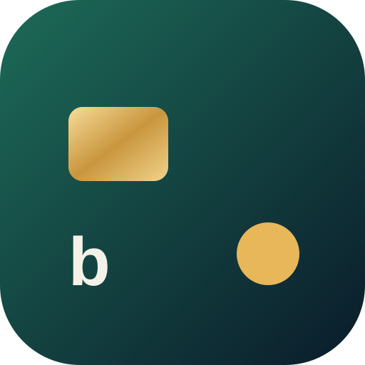

<div align="center">



# Bolso

**Finanças pessoais com IA. Você escreve do jeito que fala, o app organiza.**

"gastei 32 no ifood e 18,50 de uber ontem" vira dois lançamentos, com valor, categoria e data.

[**▶ Testar a demonstração**](https://luiz1x.github.io/agente-financeiro/)

</div>

<p align="center">
  
  
  
</p>

## Funcionalidades

- **Lançamento em linguagem natural**: a IA lê frases como "mercado 146,90" ou "recebi 500 de presente" e separa vários lançamentos numa frase só. Dá pra conferir e corrigir antes de salvar.
- **Cartão com o saldo do mês**: quanto entrou, quanto saiu e quanto sobrou. O cartão se inclina e muda o reflexo de luz ao toque.
- **Limite mensal**: anel de progresso que muda de cor perto do teto, e quanto ainda dá pra gastar por dia.
- **Gastos por categoria**, com barras proporcionais.
- **Extrato** do mês, agrupado por dia.
- **Assistente financeiro**: chat que responde perguntas sobre os seus próprios gastos.
- **Tema claro e escuro** automáticos, feito pra celular e instalável na tela inicial (PWA).

## Tecnologias

- HTML, CSS e JavaScript puro, sem framework e sem build: o app inteiro está em um arquivo.
- CSS moderno: `backdrop-filter` (vidro), `@property` (borda animada), `color-mix`, perspectiva 3D e animações com `prefers-reduced-motion` respeitado.
- Dados e IA pelos **Artifacts do Claude** (Anthropic):
  - `claude.use("db")`: banco de documentos em tempo real, com os dados de cada pessoa privados;
  - `claude.use("sample")`: chamadas ao modelo de IA para ler os lançamentos e responder no chat.
- **Modo demonstração**: fora do Claude, o app roda com dados de exemplo salvos no navegador (`localStorage`). É essa a versão publicada no GitHub Pages.

## Como rodar

**Demonstração:** abra o link acima. Para instalar no Android, abra no Chrome, toque em ⋮ e escolha *Adicionar à tela inicial*.

**Localmente:** baixe o repositório e abra o `index.html` no navegador. Não precisa instalar nada.

**Versão completa (com IA e dados salvos):** publique o `bolso.html` como Artifact no claude.ai, com as capacidades `db`, `user` e `sample`.

## Próximos passos

- [ ] Conexão com bancos via Open Finance, para importar os gastos automaticamente
- [ ] Metas de economia (ex.: guardar R$ 300 até dezembro)
- [ ] Gráfico de evolução mês a mês
- [ ] Versão independente com Supabase e API de IA própria

## Estrutura

```
index.html             versão publicada no GitHub Pages (modo demonstração)
bolso.html             versão para rodar como Artifact no Claude
manifest.webmanifest   configuração para instalar como app
icon.svg, icon-*.png   ícones
docs/                  prints das telas
```

---

Feito por **Luiz Felipe**
