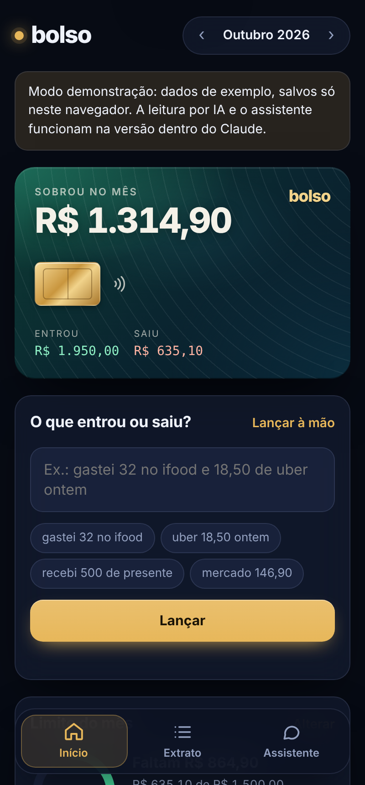
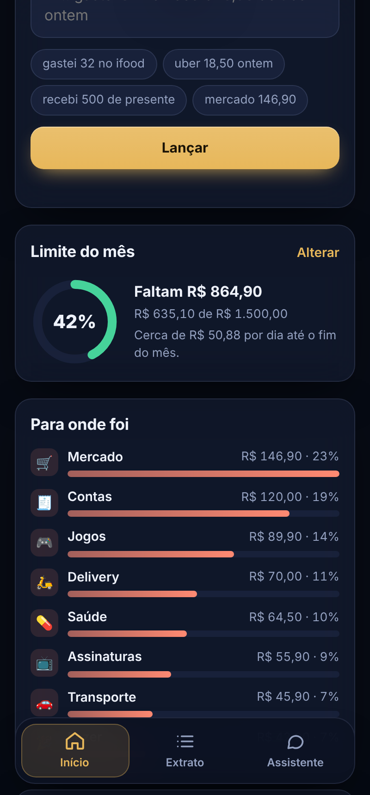
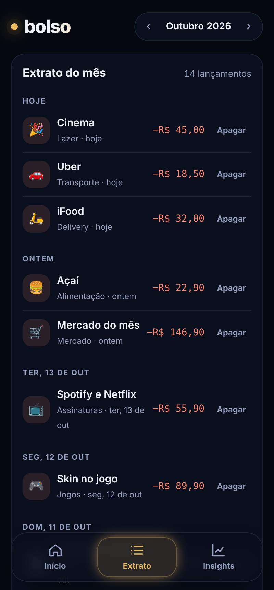

<div align="center">


# Bolso

**Finanças pessoais com IA. Você escreve do jeito que fala, o app organiza.**

"gastei 32 no ifood e 18,50 de uber ontem" vira dois lançamentos, com valor, categoria e data.

[**▶ Testar a demonstração**](https://luiz1x.github.io/agente-financeiro/)

</div>

<p align="center">
  
  
  
</p>

## Funcionalidades

- **Lançamento em linguagem natural**: frases como "mercado 146,90 e pizza 38" ou "recebi 500 de presente" viram lançamentos separados, com valor, categoria e data. Dá pra conferir e corrigir antes de salvar.
- **Cartão com o saldo do mês**: quanto entrou, quanto saiu e quanto sobrou. O cartão se inclina e muda o reflexo de luz ao toque.
- **Limite mensal**: anel de progresso que muda de cor perto do teto, e quanto ainda dá pra gastar por dia.
- **Gastos por categoria**, com barras proporcionais.
- **Extrato** do mês, agrupado por dia.
- **Insights**: média por dia, projeção do mês, comparação com o mês anterior, gráfico de gastos por dia e uma dica baseada nos seus números.
- **Assistente com IA** (na versão dentro do Claude): chat que responde perguntas sobre os seus próprios gastos.
- **Fundo animado em WebGL**, painéis com luz que segue o cursor e animações em tudo. Feito pra celular e instalável na tela inicial (PWA).

## Tecnologias

- **Next.js 14** (App Router, exportação estática) + **React 18** + **TypeScript**
- **Framer Motion**: transições entre telas, cartão 3D com física de mola, contadores animados, lista que anima ao apagar, explosão de moedas ao salvar
- **WebGL**: fundo animado feito com shader próprio (gradiente fluindo, brilho que segue o dedo e partículas), renderizado em baixa resolução para rodar leve no celular
- **Interpretador de frases** em TypeScript (`lib/parse.ts`): entende valores como "18,50", "1.250,00" e "1,8k", datas como "ontem" e "dia 5", e várias compras numa frase só
- **GitHub Actions**: a cada push, o site é compilado e publicado no GitHub Pages
- Versão com IA de verdade em `claude/bolso.html`, que roda como Artifact do Claude: dados salvos na nuvem (`claude.use("db")`) e um modelo de IA para ler os lançamentos e conversar sobre os gastos (`claude.use("sample")`)

## Como rodar

```bash
npm install
npm run dev
```

Abra http://localhost:3000. Os dados ficam salvos no navegador (`localStorage`).

## Próximos passos

- [ ] Conexão com bancos via Open Finance, para importar os gastos automaticamente
- [ ] Metas de economia (ex.: guardar R$ 300 até dezembro)
- [ ] Gráfico de evolução mês a mês
- [ ] Login e dados na nuvem com Supabase
- [ ] IA própria via API, também fora do Claude

## Estrutura

```
app/                   páginas do Next.js (layout, página e estilos)
components/            App, cartão, painéis, fundo WebGL
lib/                   tipos, cálculos e interpretador de frases
public/                ícones e manifesto do app
claude/bolso.html      versão com IA que roda dentro do Claude
.github/workflows/     publicação automática no GitHub Pages
docs/                  prints das telas
```

---

Feito por **Luiz Felipe**
